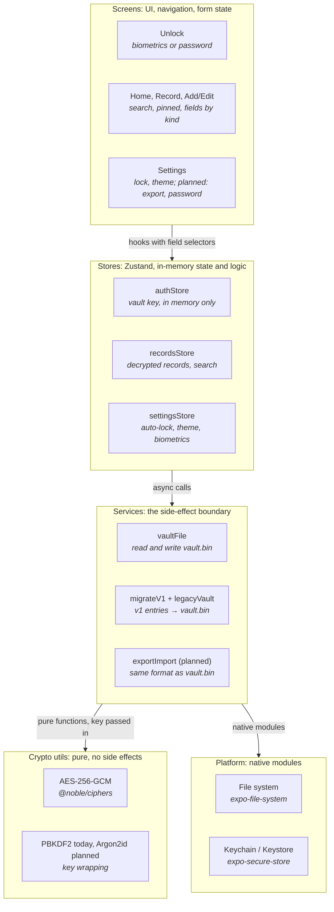
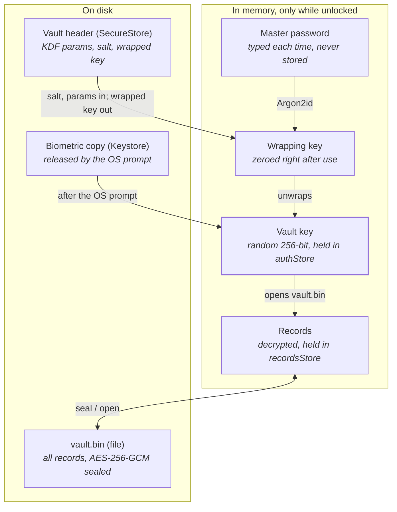

# InfoVault v2 Architecture

InfoVault v2 is a local-first vault for the things people write on scraps of paper: passwords, Greek ΑΦΜ and ΑΜΚΑ, SIM PINs, card details, Wi‑Fi passwords. Everything is encrypted on the phone under a key the user's master password unlocks, and nothing ever touches the network. This document describes the design on `main`, as agreed in [INFOVAULT_V2_SPEC.md](INFOVAULT_V2_SPEC.md); items not yet shipped are marked *planned*. The threat model is in [SECURITY.md](SECURITY.md).

## Stack

Fourteen choices, all current and all with a reason; the two that changed from v1 are record storage and the KDF.

| Layer | Choice | Why |
| --- | --- | --- |
| Runtime | Expo SDK 58, React Native New Architecture, Hermes | Current SDK; New Arch is required by Reanimated 4 and by `react-native-quick-crypto` |
| Language | TypeScript, strict, no `any` | Type errors are the main regression signal; there was no test suite until v2 |
| UI | `StyleSheet` + a theme module (`useTheme()`), light and dark | Zero styling dependencies; the theme holds the tokens Claude Design produces. NativeWind and `size-matters` removed |
| Navigation | React Navigation 7, native stack, typed `RootStackParamList` | Five screens; file routing and deep links would add nothing, and URL-openable screens are a liability in a vault |
| State | Zustand: `authStore`, `recordsStore`, `settingsStore` | One store per concern, in-memory only, hooks with field selectors |
| Record encryption | AES-256-GCM via `@noble/ciphers` | Audited, pure TypeScript, authenticated; 96-bit nonce, 128-bit tag |
| Key derivation | PBKDF2-SHA256 (100k) today; *planned:* Argon2id via `react-native-quick-crypto` (native), with PBKDF2 kept for reading older vaults | Memory-hard, OWASP's first choice; native so real parameters (64 MiB, 3 passes) fit an unlock |
| Randomness | `expo-crypto` (`getRandomBytesAsync`, `randomUUID`) | Platform CSPRNG; `Math.random()` and noble's WebCrypto-based `randomBytes` are never used |
| Record storage | One sealed file, `vault.bin`, via `expo-file-system` | No per-value size cap, one read at unlock, one atomic write per change |
| Key storage | `expo-secure-store` (iOS Keychain / Android Keystore) | Holds only the vault header and the biometric-gated key copy, which is what a keystore is for |
| Biometrics | `expo-local-authentication` + SecureStore `requireAuthentication` | The OS prompt releases the stored key copy; the app never sees biometric data |
| Screen privacy | `expo-screen-capture`, foreground overlay | Blocks screenshots and recording while unlocked; hides content in the app switcher |
| Clipboard | `expo-clipboard` with a 30-second clear | Copy is a convenience; the window is bounded |
| Build and test | EAS Build (preview APK, production bundle), Jest, GitHub Actions | CI runs typecheck, lint with zero warnings, and the test suites |

## How the parts fit together

Every layer calls only the layer below it.



Screens never touch storage; they read the stores through hooks and call store actions. Stores hold the vault key and the decrypted records in memory and contain the business logic. Services are the one place that reads or writes the device: the vault file, the v1 SecureStore layout during migration, and (planned) the share sheet. They call the pure crypto functions with the key the store hands them; the sealed container itself is a pure codec (`utils/vaultFormat.ts`). The two SecureStore entries for key material (header, biometric copy) are written by `authStore` directly, since they are its own state rather than records. Biometrics, clipboard and screen-capture services sit in the same layer and are left out of the picture for room. Same shape as v1, with the three domain stores collapsed into `recordsStore` and `secureStorage.ts` replaced by `vaultFile.ts` (its v1 layout names survive in `legacyVault.ts` for the migration).

## Records and the vault file

One record type replaces v1's three. A record is a title, a template, and an ordered list of labeled fields; the template only seeds the fields, it never limits them.

```typescript
type FieldKind = 'text' | 'secret' | 'number' | 'date' | 'url' | 'multiline';

interface Field { id: string; label: string; value: string; kind: FieldKind }

interface Record {
  id: string;
  title: string;
  template: 'login' | 'idNumber' | 'idDocument' | 'sim' | 'card' | 'wifi' | 'note' | 'custom';
  fields: Field[];
  pinned: boolean;
  tags: string[];
  createdAt: string;
  updatedAt: string;
}
```

The field kind drives the UI, not the template: `secret` is masked with reveal, auto-hide and timed copy; `number` is shown large, monospace and grouped (`123 456 789`) and is not masked by default, since an ΑΦΜ is forgotten more than it is stolen; `date` shows expiry state; `url` opens. Any field can be re-kinded, so a user can mask their ΑΜΚΑ if they want to.

On disk the whole record set is one file:

| Where | What | Why there |
| --- | --- | --- |
| `vault.bin` in the app's document directory | All records, serialized as one JSON array and sealed as one AES-256-GCM blob under the vault key, with a small versioned header | No size cap, one read at unlock, one atomic write per change, one format for backup |
| `SecureStore` entry `vaultHeader` | KDF algorithm and parameters, salt, the vault key wrapped under the password-derived key | Small, not secret, must be readable before unlock |
| `SecureStore` entry `vaultBiometricKey` | A copy of the vault key, released only after the OS biometric prompt | The only item that needs the auth-gated keystore |

SecureStore is never used for records. v1 kept one keychain entry per record, which imposed a ~2 KB cap per value (halved by hex encoding), one native round-trip per record at every unlock, and non-atomic record-plus-registry writes. Our own AES-GCM is the real protection; SecureStore's layer on top of it bought nothing.

## Keys and unlock

The password unwraps a key; that key, not the password, seals the records.



Lock zeroes the wrapping key, the vault key and the records. The password is never written anywhere.

The vault key is random and never changes when the password or the KDF does; only the wrapping around it is redone. Unwrapping it is also the password check: a wrong password fails the GCM tag, so no verifier is stored and nothing derived from the password is ever written.

### Setup

1. Generate a random 256-bit vault key and a random salt (`expo-crypto`).
2. Derive the wrapping key from the new password with Argon2id and the salt.
3. Wrap the vault key under it (AES-GCM, with associated data that separates this use from record encryption) and write the header `{ version, kdf, salt, wrappedKey }` to SecureStore in one call.
4. Write an empty `vault.bin` sealed under the vault key. Zero the wrapping key; keep the vault key in `authStore`.

### Unlock with the password

1. Read the header; derive the wrapping key from the typed password with the header's KDF parameters and salt.
2. Unwrap the vault key. A tag failure means a wrong password.
3. Zero the wrapping key. If the header's KDF parameters are older than the app's current ones, re-wrap the vault key with the current ones and rewrite the header; 32 bytes change, records do not.
4. Put the key in `authStore` and call `recordsStore.open()`: it runs the v1 migration if any v1 entries remain, reads `vault.bin` (recovering `.bak` if needed) and publishes the records. If no file exists after that (a v1 install with nothing to migrate), the record set is sealed and written now, so a header never exists without a file. `open()` resolves `true` when the records are in memory, `false` when the vault locked meanwhile, and throws when the file cannot be opened — in which case the key is zeroed again, nothing is marked unlocked and the screen shows a neutral error. Only after `true` is the session authenticated.
5. If biometric unlock is on and a biometric unlock previously found the keystore entry gone, re-store the key copy. This repairs an entry the OS invalidated after an enrollment change; it is done only after such a failure because on Android the gated write itself prompts.

### Unlock with biometrics

1. Ask SecureStore for the key copy with `requireAuthentication`; the OS shows its prompt.
2. On success the vault key is in memory; continue from step 4 above. On cancel or failure stay locked; the password field is still there.

### Lock

Triggered by the lock button, the idle timeout (checked continuously in the foreground and again on return from the background), and never skipped on error.

1. Zero the vault key bytes and drop the reference.
2. Clear the records from `recordsStore` and clear the app's clipboard copies.
3. Nothing is written. The next unlock starts again from the header and the file.

## Writing, backup and migration

Every change rewrites the whole vault file atomically; the backup file is that same file; v1 vaults are converted once, on the first unlock after the update.

### Writing a change

1. The store computes the next full record set on a serial queue, validates every record (shape and the 64 KB cap) and calls `writeVault(payload, vaultKey, isLiveKey)`.
2. The service serializes all records and seals them with the vault key and a fresh random nonce.
3. It writes `vault.bin.tmp`, moves the current `vault.bin` to `vault.bin.bak`, moves `.tmp` into place and drops `.bak`. A crash at any step leaves a decodable file, and the next read restores the last acknowledged one.
4. If the vault locked while sealing (the key bytes were zeroed), the write is abandoned rather than persisted under a dead key. v1 had this check; it stays. Only after the write lands does the store publish the new records to state.

### Export (planned)

1. Settings → Export asks for the master password again: it confirms intent and lets the wrapping key be derived fresh.
2. The export file is the vault header plus the sealed blob, the same bytes and format as on disk.
3. The file goes to the OS share sheet. Where it ends up is the user's choice; the app never knows.

### Import (planned)

1. Pick a file; read its header.
2. Derive the wrapping key from the typed password with the file's own KDF parameters and salt; unwrap its vault key; open the blob.
3. On an existing vault, merge by record id (newer `updatedAt` wins) and save as a normal write. On a fresh install the import becomes the vault: its header is written to SecureStore and the file to disk.

### Migration from v1

1. The header migration already exists ([PR #28](https://github.com/terzidest/InfoVault/pull/28)): the v1 salt and verifier become a header, and the v1 password-derived key becomes the vault key, so nothing is re-encrypted.
2. Each v1 record is read from SecureStore, decrypted with the vault key and mapped: `Credential` → Login, `PersonalInfo` → ID document (or ID number when only the identifier is set), `Note` → Note with its category as a tag.
3. `vault.bin` is written. Only then are the v1 entries and their key registries deleted. An interruption before that point leaves v1 intact and the migration retries next unlock.
4. iOS keeps Keychain entries across an uninstall. Key material (header, legacy salt or setup flag) with no `vault.bin` (nor a `.bak`) and no v1 entries means a fresh install or an interrupted setup: the header, legacy entries, biometric copy and setup flag are cleared and setup runs. Setup also removes any stale vault file before writing the new empty one.

## Decisions

Ten choices with the alternative each one beat. The first four change what v1 did; the rest keep v1's direction on purpose.

| Decision | Instead of | Why |
| --- | --- | --- |
| One record type with kinded fields | Three fixed types | ΑΦΜ, SIM PINs, cards and Wi‑Fi passwords fit none of the three and ended up as free text in Notes |
| One sealed vault file | A SecureStore entry per record | ~2 KB cap per value, one native call per record at unlock, non-atomic writes; our own AES-GCM already protects the data |
| Argon2id, native | PBKDF2-SHA256 at 100k iterations in pure JS | Memory-hard; OWASP's 600k PBKDF2 is unusable on Hermes; native lets real parameters fit an unlock |
| Wrapped vault key with stored KDF parameters | A key derived straight from the password | KDF upgrades and password changes re-wrap 32 bytes; no re-encryption, no lock-out of existing vaults |
| `@noble/ciphers` for AES, `quick-crypto` for Argon2id only | `quick-crypto` for everything | Audited pure AES with a tiny per-write cost; the smallest native surface that solves the real problem |
| `StyleSheet` + theme module | NativeWind | Zero styling dependencies; NativeWind is the one dependency that has broken Metro; design tokens map straight onto a theme object |
| React Navigation 7 | Expo Router | Five screens; file routing adds nothing and deep links are a liability in a vault |
| Dev builds, EAS APK, Appetize | Expo Go | Expo Go runs only the latest SDK and cannot show biometric unlock; the APK is the real app |
| `allowBackup=false` | Android auto-backup | "Data never leaves the device" should be literally true, ciphertext included |
| No sync, no system autofill, no attachments | Feature breadth | Sync contradicts local-first; autofill is weeks of native work per platform; attachments change the storage model. Depth over breadth for a portfolio piece |

### Sources

- [INFOVAULT_V2_SPEC.md](INFOVAULT_V2_SPEC.md), the agreed scope and sequence
- [SECURITY.md](SECURITY.md), the threat model
- [PR #28](https://github.com/terzidest/InfoVault/pull/28), the vault header and key wrapping
- [OWASP Password Storage Cheat Sheet](https://cheatsheetseries.owasp.org/cheatsheets/Password_Storage_Cheat_Sheet.html), KDF recommendations

---

*Describes `main`; sections marked planned (Argon2id, export/import, change password, the Unlock/Setup redesign) are not shipped yet. Update it in the same change as any decision it records.*
