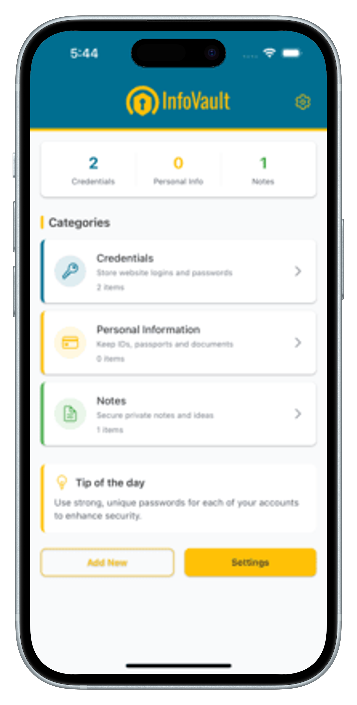

# InfoVault

<div align="center">
  
</div>

InfoVault is a local-first, secure personal information manager built with React Native and Expo: one place for the things you would otherwise write on a scrap of paper — logins, ΑΦΜ / ΑΜΚΑ and other ID numbers, passports and licences, SIM PINs and PUKs, card details, Wi‑Fi passwords, private notes. Everything is sealed on the device under a key your master password unlocks — data never leaves the phone.

> The full threat model — what InfoVault protects against and what it deliberately does not — lives in [SECURITY.md](SECURITY.md).

## Try it

- **In your browser:** [live demo on Appetize](https://appetize.io/app/b_po4aou3mjf27ojws3ogxk5iytq). It's a real Android build streamed from a remote emulator, with nothing to install. It's a shared remote device, so use made-up data, not real secrets. Biometric unlock can't be shown there.
- **On an Android phone:** [download the APK](https://github.com/terzidest/InfoVault/releases/latest/download/InfoVault.apk) and install it. You'll need to allow installs from your browser, since the app isn't on the Play Store. This is the full experience, including fingerprint unlock and screenshot blocking.

## Features

- **Master-password vault** — everything is encrypted client-side; the master password is never stored, and the encryption key exists only in memory while the vault is unlocked
- **Biometric unlock** — optional fingerprint/face unlock, backed by a key held in the platform keystore behind the OS biometric gate; the Unlock screen names the method the phone has and offers the master password alongside it
- **One record type, eight templates** — Login, ID number, ID document, SIM, Card, Wi‑Fi, Note and Custom seed a record's fields; any field can be added, relabeled, reordered or re-kinded (text, secret, number, date, url, multiline)
- **Fields rendered by kind** — secrets masked with reveal, auto-hide and timed copy; identification numbers large, monospace and grouped for reading out; dates show expiry; urls open
- **Search-first Home** — the search box is the first thing on screen, filtering titles, labels, tags and non-secret values; pinned records sit above the list; every row has a one-tap copy
- **Password generator** — CSPRNG-backed, attached to any secret field
- **Light and dark themes** — follows the system or pinned in Settings

## Security

- **Encryption**: the whole record set is one AES-256-GCM blob (`@noble/ciphers`) in a sealed vault file, under a random vault key that is wrapped by a key derived from the master password with PBKDF2-SHA256 (100k iterations); KDF parameters are stored per vault so they can be raised without re-encrypting records
- **Storage**: records never touch the platform keystore; it holds only the vault header and the optional biometric key copy. Every change rewrites the vault file atomically, with a backup that survives an interrupted write
- **Key handling**: in memory only while unlocked; the session counts as unlocked only once the vault file has been opened; locking zeroes the key and evicts all decrypted records from state
- **Auto-lock**: idle timeout enforced continuously while the app is open and re-checked when returning from the background
- **Screen privacy**: screenshots/recording blocked while unlocked; an opaque overlay hides content in the OS app switcher
- **Clipboard hygiene**: copied secrets auto-clear after 30 seconds, and immediately on lock
- **Display masking**: secret fields are masked by default with an auto-hiding reveal, and are excluded from search
- **Randomness**: all security-relevant randomness comes from `expo-crypto` (CSPRNG); `Math.random()` is never used

## Getting Started

### Prerequisites

- Node.js 22.13+ (or 24.3+)
- For device builds: Xcode (iOS) / Android SDK (Android)

### Installation

```bash
git clone https://github.com/terzidest/InfoVault.git
cd InfoVault
npm install
```

### Running

```bash
npm start          # Metro dev server for an installed dev build
npm run ios        # build & run the iOS dev app
npm run android    # build & run the Android dev app
```

The app runs as a dev build, not in Expo Go: it targets Expo SDK 58, and the store versions of Expo Go only support the latest SDK. After changing native dependencies, rebuild with `npm run ios` / `npm run android` rather than only reloading Metro.

### Android preview build (shareable APK)

Built in the cloud with [EAS Build](https://docs.expo.dev/build/introduction/). It needs a free Expo account but no local Android SDK:

```bash
npx eas-cli login
npx eas-cli init                                      # first time only: links the project to your Expo account
npx eas-cli build --platform android --profile preview
```

The build ends with an install page link and QR code. Anyone with the link can install the APK on an Android device, with "install unknown apps" allowed.

### Quality checks

```bash
npm run typecheck  # strict TypeScript, no emit
npm run lint       # ESLint, zero-warning policy
npm test           # Jest: real stores and crypto against in-memory native mocks
```

All three run in CI on every pull request, along with a bundle export.

## Project Structure

```
src/
├── assets/          # Images
├── components/
│   ├── ui/          # Token-driven primitives (Screen, TextField, ActionButton, ListRow, ...)
│   └── features/
│       ├── records/ # Record UI: FieldValue, RecordRow, PinnedCard, FieldEditorRow, GeneratorSheet
│       ├── vault/   # The SVG vault door and its glow/ripple (Unlock, Setup)
│       └── AutoLockGate.tsx
├── screens/         # Home, RecordScreen, AddEditRecordScreen, settings/, auth/ (Unlock, Setup)
├── store/           # Zustand: authStore (key, unlock), recordsStore (records), settingsStore
├── services/        # Side-effect boundary: vaultFile, migrateV1, legacyVault, biometrics, clipboard
├── navigation/      # Typed native stack (six screens)
├── theme/           # Design tokens (light + dark), ThemeProvider, useTheme
├── utils/           # Pure functions: crypto, vaultFormat, records, formatters, validation, password, passwordRules
├── hooks/           # useAuth
└── types/           # Shared models and navigation types
```

## Technology Stack

- **React Native + Expo** (dev builds; TypeScript strict mode)
- **@noble/ciphers / @noble/hashes** — AES-256-GCM and PBKDF2
- **Expo File System** — the sealed vault file
- **Expo Secure Store** — platform keystore for the vault header and biometric key copy
- **Expo Local Authentication** — biometric gate
- **Zustand** — state management
- **React Navigation** (native stack)
- **Reanimated + react-native-svg** — list entrance motion and the vault-door unlock sequence

## Roadmap

- Encrypted export / import — the vault file format already is the backup format; the share-sheet flow and the password re-prompt are what remain
- Change-master-password flow (re-wraps the vault key; records are untouched)
- Argon2id as the default KDF — supported by the vault format, pending a native implementation and on-device latency measurement (see [SECURITY.md](SECURITY.md))

## Acknowledgments

- Expo team for the React Native toolchain
- Paul Miller for the noble cryptography libraries
- React Navigation, Zustand, and Ionicons
